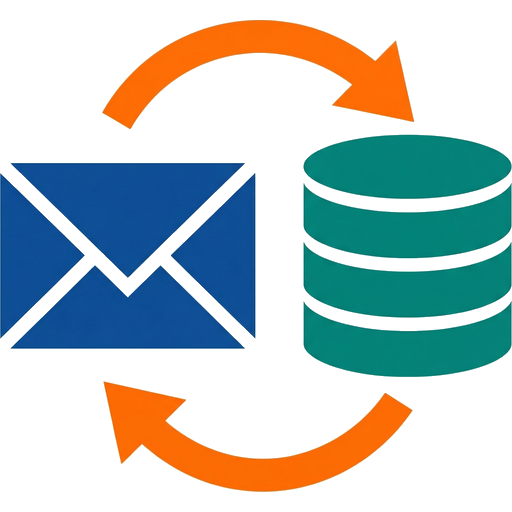

<p align="center">
  
</p>

<table>
<tr>
<td width="100">

</td>
<td>
<h1>PostIMAP</h1>
Your mailbox as PostgreSQL tables, in both directions.
</td>
</tr>
</table>

[](https://github.com/frederikb96/postimap/actions/workflows/ci.yaml)
[](https://github.com/frederikb96/postimap/releases)
[](https://opensource.org/licenses/MIT)

PostIMAP mirrors IMAP mailboxes, and CalDAV calendars and CardDAV address books, into PostgreSQL:
every message, body and attachment, kept in sync both ways. Your app reads and writes plain SQL.
Mark a row read and the mail server sees `\Seen`; new mail arrives and a row appears. PostIMAP
handles the protocols in the background.

## Why

- **IMAP is slow and complex.** It is a 40-year-old protocol with inconsistent server
  implementations. PostIMAP absorbs that so your app doesn't have to.
- **PostgreSQL is the only interface.** No REST API, no SDK. Your app reads and writes SQL, and
  listens on one notification channel. The write contract is enforced with column-level grants,
  so a write outside it fails with `permission denied` instead of silently doing nothing.
- **Full replication.** PostgreSQL always has a complete copy. No on-demand fetching, no lookback
  window, no lazy loading: `SELECT * FROM messages` gives you everything, searchable with
  PostgreSQL's own full-text search.
- **Bidirectional.** Flags, moves, deletes, new folders, sent mail and drafts go back to the server.
  Changes made in any other mail client come in.

## How it fits together

```
your app  ⇄  PostgreSQL (SQL + LISTEN/NOTIFY)  ⇄  PostIMAP  ⇄  IMAP, SMTP, CalDAV, CardDAV servers
```

Your app and PostIMAP never talk to each other directly; they share a database. Triggers pick up
your app's writes and queue them for the server. PostIMAP writes what it learns from the server
and announces each change on the `postimap_events` channel. The server is authoritative: when in
doubt, its state wins. [docs/how-it-works.md](docs/how-it-works.md) has the detail.

## Using it from your app

Add an account, and PostIMAP starts syncing it without a restart:

```sql
INSERT INTO accounts (name, imap_host, imap_port, imap_user, imap_password)
VALUES ('me@example.com', 'imap.example.com', 993, 'me@example.com',
        '\x00' || convert_to('the-password', 'UTF8'));
```

Read the inbox:

```sql
SELECT m.subject, m.from_addr, m.received_at, m.is_seen
FROM messages m JOIN folders f ON f.id = m.folder_id
WHERE f.special_use = 'inbox' AND m.expunged_at IS NULL
ORDER BY m.received_at DESC;
```

Mark a message read, and send one (sending needs the account's `smtp_*` columns set as well):

```sql
UPDATE messages SET is_seen = true WHERE id = $1;

INSERT INTO outbox (account_id, kind, to_addrs, subject, body_text)
VALUES ($1, 'send', '["them@example.com"]', 'Hello', 'Hi there.');
```

Watch for changes:

```sql
LISTEN postimap_events;
```

That is the whole integration. [docs/consumer-contract.md](docs/consumer-contract.md) is the
authoritative reference: every table, exactly which columns a consumer may write, the
notification payloads, the credential format, and worked SQL for moving, deleting, drafts,
folders, calendars and contacts.

## Run it

### Kubernetes

A Helm chart ships in [`charts/postimap`](charts/postimap) and is published to GHCR as an OCI
artifact on every release:

```bash
helm install postimap oci://ghcr.io/frederikb96/charts/postimap \
  --version <version> -f my-values.yaml
```

PostgreSQL is external by design; the chart does not own a database lifecycle.
[`charts/postimap/examples/cnpg-cluster.yaml`](charts/postimap/examples/cnpg-cluster.yaml) shows a
CloudNativePG cluster with a separate application role, and
[`examples/values-production.yaml`](charts/postimap/examples/values-production.yaml) points the
chart at it. The [chart README](charts/postimap/README.md) covers the rest.

Chart values map onto the same override file the image already reads, so there is no second
configuration mechanism to learn. Run **one replica**: the service holds per-account orchestrator
state and long-lived IMAP IDLE connections, and the chart's schema refuses anything else.

### Containers without a cluster

```bash
cp .prod.env.example .prod.env   # fill in real secrets
podman compose --env-file .prod.env -f compose.yaml up -d
```

Health checks: `GET /healthz` (liveness — the process is up) and `GET /readyz` (readiness — the
database is reachable and the orchestrator has started; a fresh deployment with no accounts yet,
or one that is mid-retry, is correctly Ready).

## Configuration

All defaults and options are in [`config/config.yaml`](config/config.yaml), the single source of
truth for configuration. Three layers merge at startup, highest priority last:

- **`config/config.yaml`** — defaults, bundled in the image
- **`config-custom/config.override.yaml`** — sparse overrides per deployment, mounted at runtime
- **Environment variables** — `${VAR}` placeholder resolution, plus `POSTIMAP_SECTION_KEY`
  overrides (for example `POSTIMAP_DATABASE_HOST`)

Secrets use `${VAR}` placeholders in the YAML, resolved from environment variables at startup:

- `DB_PASSWORD` — PostgreSQL password
- `ENCRYPTION_KEY` — 64 hex characters (AES-256-GCM). Optional: set it and PostIMAP encrypts
  stored IMAP/SMTP credentials at rest when it starts each account; unset, they stay in the
  plaintext format a consumer writes

## Non-goals

Deliberately out of scope, to keep "dumb mirror plus outbox" the whole product:

- Quota enforcement
- Cross-folder message dedup — a `folder_id` + `imap_uid` row *is* the mirrored object; a server
  that duplicates a message across folders (Gmail's All Mail) gets mirrored faithfully, not
  collapsed
- Server-side search beyond the `search_vector` tsvector column — semantic or embedding search is
  a consumer concern
- POP3, JMAP
- Recurrence expansion and scheduling (iTIP) — a `dav_objects` row is the resource as the server
  stores it, and invitations are the consumer's to send
- Subject-based thread fallback — `thread_id` resolves only via References/In-Reply-To; a consumer
  needing the edge cases that heuristic covers builds it on top of the raw headers, which stay
  available on every row

## Docs

- [docs/consumer-contract.md](docs/consumer-contract.md): the contract a consuming app works
  against — tables, writable columns, notifications, worked examples
- [docs/how-it-works.md](docs/how-it-works.md): change detection, IDLE, the outbound queue, the
  outbox, threading, DAV sync, retention, and the tables
- [docs/development.md](docs/development.md): running the tests, the test layers, the tech stack
- [charts/postimap/README.md](charts/postimap/README.md): the Helm chart

## Built on PostIMAP

[MailVerdict](https://github.com/frederikb96/mail-verdict) is a self-hosted mail client with an AI
layer. It reads and writes mail, calendars and contacts through PostIMAP alone, without a single
IMAP or SMTP import of its own.

## License

[MIT](LICENSE) — Frederik Berg
